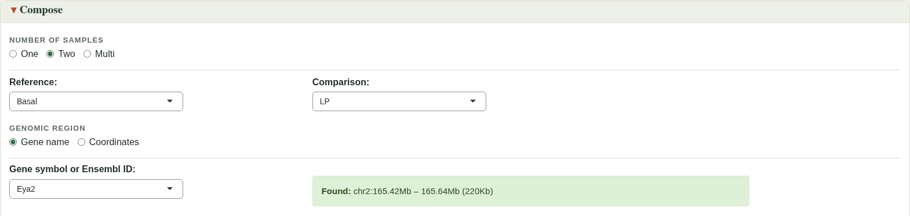
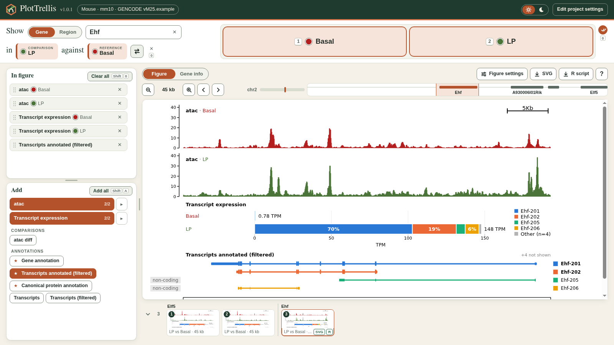
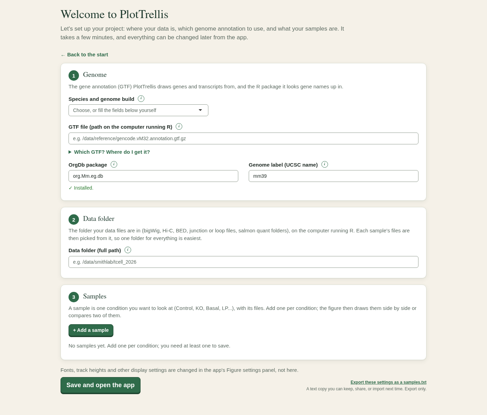

```{r opts, include=FALSE}
knitr::opts_chunk$set(message = FALSE, warning = FALSE)
```

PlotTrellis turns your sequencing data into multi-track genomic figures (transcript expression,
transcript structures, splice junctions, coverage, comparisons between samples), in a
point-and-click app or in a few lines of R.

# Installation

PlotTrellis is not on CRAN, so `repos` tells R where to find it. `BiocManager::repositories()`
adds the Bioconductor and CRAN packages that match your R. From scratch this takes 40 to
50 minutes on Linux (adding `Ncpus = 4` speeds it up):

```{r install, eval=FALSE}
install.packages("BiocManager")
install.packages("PlotTrellis", repos = c("https://aleks-wehi.r-universe.dev",
                                          BiocManager::repositories()))
```

# Your first figure in the app

PlotTrellis ships one example: mouse mammary basal cells (Basal) and luminal progenitors (LP)
around the *Elf5*, *Ehf* and *Cat* genes.

```{r app-example, eval=FALSE}
if (!requireNamespace("org.Mm.eg.db", quietly = TRUE)) BiocManager::install("org.Mm.eg.db", update = FALSE)   # mouse gene annotation (for human data: "org.Hs.eg.db")
library(PlotTrellis)
run_plottrellis(project_dir = "PlotTrellis-example", samples_txt = pt_example())
```

A `samples.txt` is a text file listing a project's samples and their data files, and
`pt_example()` gives the path of the example's. `project_dir` is the folder that holds
everything PlotTrellis makes for this project. Here it is created in R's working directory,
but it can be any folder. Without it, the project is in `~/PlotTrellis`.

The app opens with *Elf5* and its tracks already picked: click **Generate figure**. Then try
*Ehf* or *Cat*, or a different set of tracks.

To build your own figure on the **Compose** page, choose how many samples and which ones, then
a gene or coordinates:

```{r compose-screenshot-1, echo=FALSE, out.width="100%"}

```

Drag tracks into the figure (drag again to reorder) and click **Generate figure**. The title,
fonts, heights and colours are under **Figure settings**. The **Output** page downloads the
figure as an SVG or as a standalone R script, and shows the gene's transcripts and protein
domains.

```{r compose-screenshot-2, echo=FALSE, out.width="100%"}

```

To use PlotTrellis from R code instead, see
[Your first figure in code](#your-first-figure-in-code) below.

# Your own data

The simplest way is to run the command above with a new `project_dir` and no `samples_txt`:

```{r own-data, eval=FALSE}
run_plottrellis(project_dir = "my-project")
```

A wizard guides you through listing your samples and their files, and saves them in the
project folder as `project_samples.txt`. When you click **Save** (or **Close**), close that browser tab: the app
reopens in a new tab from RStudio a few seconds later. To come back, run the same command.
If a new `project_dir` already holds a `project_samples.txt`, the wizard offers to import it.

```{r wizard-screenshot, echo=FALSE, out.width="100%"}

```

# Your genome: GTF, OrgDb and genome label

Apart from your data, a project needs three things about its genome. The wizard asks for
them; a `samples.txt` gives them as `gtf_path`, `orgdb` and `genome_label` (see below).
PlotTrellis works with mouse and human.

**The GTF** is the annotation file that says where each gene and transcript is. You always
give your own, so which release to use is your choice. It can
stay gzipped (`.gtf.gz`). The first time a GTF is used, PlotTrellis builds an index from it:
1 to 3 minutes for a whole genome, once per GTF file.

- **Use the release your quantification used**: the GTF from the same GENCODE or Ensembl release
  as the transcript sequences Salmon was run on. PlotTrellis matches each transcript in your
  `quant.sf` files to the GTF by its ID (the version after the dot, e.g. `.9`, is ignored). A
  transcript the GTF does not have is left out of the expression tracks, and out of the gene's
  total with it; a transcript only the GTF has shows as zero. The transcript shapes drawn come
  from the GTF too. For GENCODE, Salmon must have been run with `--gencode`; without it every
  transcript name in `quant.sf` is a long `|`-joined string that matches nothing, and each
  Transcript expression track says, for example, "none of Elf5's transcripts are in this
  sample's quant file".
- **GENCODE or Ensembl, not RefSeq.** PlotTrellis finds a gene by looking its name up in the
  OrgDb package (below), which gives the gene's Ensembl ID (`ENSG...`, `ENSMUSG...`), and then
  finds that ID in the GTF. GENCODE and Ensembl GTFs use Ensembl IDs. RefSeq (NCBI) GTFs use
  other IDs, and PlotTrellis stops with a message if it is given one. The OrgDb's gene names
  and Ensembl IDs come from NCBI, so a gene NCBI does not link to an Ensembl ID (some lncRNAs
  and `Gm` genes), or one whose ID changed since an old GTF, is not found.
- **GENCODE gives the most.** An Ensembl GTF draws every track, but it has no APPRIS labels, so
  Gene info shows APPRIS as "none". PlotTrellis reads the CCDS IDs from both kinds of GTF (the
  two name the attribute differently), so Gene info shows them and the protein domain track
  finds the canonical transcript by CCDS ID for either. Ensembl
  releases before 104 also lack the "Ensembl canonical" tag, so no transcript is shown in bold.
  GENCODE releases before 38 (mouse M27), including M25 and 19, lack that tag too: Gene info
  says "no" for every transcript, and the bold comes from APPRIS instead (with GENCODE 19 the
  bold still appears, but Gene info shows APPRIS as "none").
- **Ensembl chromosome names become UCSC ones.** In an Ensembl GTF (no name starting with
  `chr`), the main chromosomes (`1`, `X`, `MT`) become `chr1`, `chrX`, `chrM` in the index
  PlotTrellis builds from it, so gene and region figures (e.g.
  `region = "chr2:103300000-103500000"`) work as they do with GENCODE; type regions with
  `chr`. Unplaced scaffolds (e.g. `JH584299.1`) keep their Ensembl names. Your coverage, Hi-C
  and junction files can name chromosomes either way (`chr2` or `2`); PlotTrellis matches them.

**Where to download it:**

- GENCODE: [human](https://www.gencodegenes.org/human/) or
  [mouse](https://www.gencodegenes.org/mouse/), the "Comprehensive gene annotation" GTF
  (region "CHR"). Earlier releases are under "Releases" on the same page.
- Ensembl: `https://ftp.ensembl.org/pub/release-<N>/gtf/<species>/`, the file named
  `<Species>.<build>.<N>.gtf.gz`, e.g.
  [Mus_musculus.GRCm38.100.gtf.gz](https://ftp.ensembl.org/pub/release-100/gtf/mus_musculus/).
  Human GRCh37 is under `https://ftp.ensembl.org/pub/grch37/` instead.

**The OrgDb package** (`orgdb`) maps gene names to Ensembl IDs. Install it once, e.g.
`BiocManager::install("org.Mm.eg.db")`. **The genome label** (`genome_label`) is the build's
UCSC name: PlotTrellis fetches the chromosome lengths from UCSC by it the first time each
GTF is used (this needs internet).

| Species, build | GENCODE releases | Ensembl releases | `orgdb` | `genome_label` |
|---|---|---|---|---|
| Mouse, GRCm39 | M26 and later | 103 and later | `org.Mm.eg.db` | `mm39` |
| Mouse, GRCm38 | M25 and earlier | 68 to 102 | `org.Mm.eg.db` | `mm10` |
| Human, GRCh38 | 20 and later | 76 and later | `org.Hs.eg.db` | `hg38` |
| Human, GRCh37 | 3c to 19 (not the "lift37" files) | 55 to 75, or the GRCh37 archive | `org.Hs.eg.db` | `hg19` |

The build must be the one your reads were aligned to. GENCODE's "lift37" GTFs (newer releases
mapped back to GRCh37) carry IDs such as `ENSG00000290825.1_1`, which PlotTrellis cannot match
to gene names, so no gene will be found: use GENCODE 19 instead.

# Your first figure in code

The rest of this vignette is for working in R. The example figure from the app:

```{r code-example, eval=FALSE}
library(PlotTrellis)
proj <- pt_project(project_dir = "PlotTrellis-example", samples_txt = pt_example())
fig  <- pt_figure(proj, "Elf5", tracks = c("atac", "transcript_expression", "transcripts_annotated", "genes"))
pt_save(fig, "Elf5.pdf")   # or .svg, .png
```

```{r code-example-run, echo=FALSE, fig.alt="Elf5 in mouse mammary basal cells and luminal progenitors: ATAC coverage and transcript expression for each, then the annotated transcripts and the gene."}
library(PlotTrellis)
proj <- pt_project(project_dir = file.path(tempdir(), "PlotTrellis-example"), samples_txt = pt_example())
pt_figure(proj, "Elf5", tracks = c("atac", "transcript_expression", "transcripts_annotated", "genes"))
```

# Your own data in code (writing a samples.txt)

A project can also come from a `samples.txt`, a tab-separated table with one row per
sample under a few header lines. Separate the columns with a tab, not spaces (the example
below is written with tabs, so copying it works). For example:

```
# data_root: /data/smithlab/tcell_2026
# gtf_path: /data/reference/gencode.v44.annotation.gtf.gz
# orgdb: org.Hs.eg.db
# genome_label: hg38
condition	colour	bw:atac	paired-end:junctions	quantdir:salmon
Control	#1b9e77	atac/Control_merged.bw	junctions/Control_SJ.bed	salmon/Control
KO	#d95f02	atac/KO_merged.bw	junctions/KO_SJ.bed	salmon/KO
```

The lines starting with `#` are the project's settings:

- `data_root`: the folder your data files are in. The paths in the table are relative to it.
- `gtf_path`: your genome's GTF file (see above).
- `orgdb`: your species' annotation package, `org.Mm.eg.db` (mouse) or `org.Hs.eg.db` (human).
- `genome_label`: the genome build's UCSC name, e.g. `mm10`, `hg38` (table above).
- Any other app setting, e.g. `# fontsize: 12`. A project's `project_samples.txt` lists the
  ones changed from their defaults.

The columns (separated by tabs):

- `condition`: the sample's name.
- `colour` (optional): the sample's colour.
- One column per kind of data file, headed `type:name`. The type says what the file is, and the
  name is what you call the track: `bw:atac` holds bigWig files and gives tracks called `atac`.
  - **type**: one of the types in the table below (`bw`, `quantdir`, `paired-end`, `hic`, `bed`).
  - **name**: the data, e.g. `ATAC`, `CUT&RUN`, `HiC`, `Loops` (a `quantdir` column always gives
    `transcript_expression`). Tracks with the same name belong together: coverage (`bw`), Hi-C
    and arc (`paired-end`) tracks with one name share one scale, so every sample's `ATAC` track
    gets the same y-axis and the samples can be compared by eye, and the app offers comparison
    tracks (one sample against another) only for a name both samples have. Different names get
    separate scales, so `bw:ATAC` and `bw:CUT&RUN` are each scaled within their own group. Names
    must match exactly, including upper and lower case.
  - **One column per data type, one row per sample.** Each sample's file for that data type
    goes in its own row; leave a cell empty if a sample doesn't have that data.

  Not one column per sample: a column per sample gives every sample a different track name, so
  each sample gets its own scale and there are no comparison tracks. Wrong:

  ```
  condition	bw:Grans ATAC	bw:pDC ATAC	hic:Grans HiC	hic:pDC HiC
  Grans	atac/Grans.bw		hic/Grans.hic	
  pDC		atac/pDC.bw		hic/pDC.hic
  ```

  Right, one column per data type, a row per sample:

  ```
  condition	bw:ATAC	hic:HiC
  Grans	atac/Grans.bw	hic/Grans.hic
  pDC	atac/pDC.bw	hic/pDC.hic
  ```

| Type | File | Track |
|---|---|---|
| `bw` | bigWig | coverage (ATAC-seq, RNA-seq) |
| `quantdir` | a Salmon output folder (with `quant.sf`) | `transcript_expression` |
| `paired-end` | BED12 or BED6 junctions, BEDPE, or a HiCCUPS loop file as it comes | arcs between two regions (splice junctions, loop calls) |
| `hic` | `.hic`, `.cool`, `.mcool` | Hi-C contact map |
| `bed` | BED, 3 or more columns | intervals (peaks, regions) as plain boxes on one row |

`bed` and `paired-end` files can also be gzipped (for example `peaks.bed.gz`, `loops.bedpe.gz`).

An arc's height is its count: the score column of a BED12 or BED6 junction file (column 5), or of
a BEDPE (column 8). A BEDPE without a score column takes it from column 7 when that is a number on
every row (as in ENCODE's ChIA-PET loops); otherwise every arc has the same height.

Then open it like the example: `run_plottrellis(project_dir = "my-project", samples_txt =
"path/to/samples.txt")`. The project keeps its own copy, as `project_samples.txt`. Editing your
`samples.txt` later updates the project the next time you run this command.

## Let an AI assistant write it

If you would rather not write it by hand, a chat AI (ChatGPT, Claude, Copilot or another) can
do it with you. Copy the prompt below into a new chat. It asks for what you have (a list of your
files, a screenshot of a folder, or a sample sheet), checks each file against what PlotTrellis
reads, confirms the samples and columns with you, and ends with a `samples.txt` to save. The
same prompt has its own page: `vignette("samples-txt-ai-prompt", package = "PlotTrellis")`.

<details><summary>The prompt (click to open, then Copy)</summary>

```{r ai-prompt, echo=FALSE, comment=""}
cat(readLines(system.file("samples_txt_ai_prompt.md", package = "PlotTrellis", mustWork = TRUE)), sep = "\n")
```

</details>

# More in code

- **Tracks** are listed top to bottom. `pt_tracks(proj)` lists every one the project has.
  `genes`, `transcripts_annotated` and the other annotation tracks need no sample; the rest
  are drawn for every sample, in `samples.txt` order, as in the figure above, unless you
  say which:
- **`samples = "LP"`** draws every track for that one sample. A `samples` as long as
  `tracks` gives each track its own, with `NA` for tracks that need none:
  `tracks = c("atac", "atac", "genes"), samples = c("LP", "Basal", NA)`.
- **`comparison = c("Basal", "LP")`** draws every per-sample track for those samples, in that
  order, and gives comparison tracks their two samples, the first being the reference:
  `pt_figure(proj, "Elf5", c("atac", "atac_diff", "genes"), comparison = c("Basal", "LP"))`.
- **`order = "sample"`** groups the tracks by sample (all of Basal's, then all of LP's)
  instead of by track. Tracks without a sample stay where they are written, so write them
  first or last.
- **Numbers** work instead of names, e.g. `tracks = c(6, 1), samples = 2`: `pt_tracks(proj)`
  and `pt_samples(proj)` (or `print(proj)`) list them. They change when `samples.txt` does, so
  use names in scripts you keep. Sample names are written exactly as in `samples.txt`.
- **`region = "chr2:103,400,000-103,460,000"`** instead of a gene shows any coordinates.
- **`pt_script(fig, "Elf5.R")`** writes a standalone script that redraws the figure, for
  edits the API doesn't offer.
- **`run_plottrellis(proj)`** opens the same project in the app, and
  `pt_preload(proj, fig)` makes it open on `fig`, ready for someone who doesn't code.

Everything a project keeps (settings, a copy of its samples table, caches) is in its
`project_dir`; your data files stay where they are.

# Sharing

To pass your data to someone else, send them the path to your `samples.txt` (for a wizard
project, the `project_samples.txt` in its folder). They run the same command with a
`project_dir` of their own:

```{r sharing, eval=FALSE}
run_plottrellis(project_dir = "tcell-project",
                samples_txt = "/data/smithlab/tcell_2026/samples.txt")
```

They need to be able to read your data files, so keep them on a shared drive and give
`data_root` and `gtf_path` as full paths.

Their project is a copy: what they change stays in their `project_dir`. A later edit to your
`samples.txt` reaches them when they rerun this command, unless they have changed their
project since, and it replaces the settings they changed in the app.

To have the app open on a gene with its tracks
already picked, as the example does, add two header lines:

```
# start_gene: Elf5
# start_tracks: atac, transcripts_annotated, genes
```

The tracks are drawn for every sample; `# start_samples:`, `# start_comparison:` and
`# start_order:` lines work as `samples`, `comparison` and `order` do in `pt_figure()`
(names, comma-separated, `NA` for a track without a sample).

# Troubleshooting

Everything PlotTrellis writes for a project is inside its `project_dir`: the settings, a copy
of the samples table and a `cache/` folder (the genome files built from your GTF, chromosome
lengths, and what it looked up per gene). It never writes beside your GTF or in your data
folders. The app's Edit project settings dialog shows the folder's path. Close the app first,
then:

- **To rebuild the caches** (for example when a figure looks stale), delete the `cache/`
  folder. The next start rebuilds what it needs: a full genome annotation takes 1 to 3
  minutes, and chromosome lengths are fetched from UCSC, which needs an internet connection.
  The app's Edit project settings, Advanced, Clear all caches does the same.
- **To start fresh**, delete the whole `project_dir`, then create the project again from your
  `samples.txt`. A project made in the wizard has its samples table only in the folder: copy
  its `project_samples.txt` somewhere else first, and create the project from that copy. This
  is safe only if the folder holds nothing but PlotTrellis's files, so don't use your data
  folder as a `project_dir`.

Earlier versions kept their genome caches beside the GTF (files ending in `_txdb.sqlite`,
`_tx_names.rds`, `_tx_meta.rds` and `_chrom_sizes.rds`). They are no longer used, and you can
delete them.

<style>
.code-box { position: relative; margin: 0 150px 0.5em 0; }
@media screen and (max-width: 991px) { .code-box { margin-right: 0; } }
.code-box pre { margin: 0; }
.copy-code { position: absolute; top: 4px; right: 4px; font-size: 12px; }
</style>
<script>
if (navigator.clipboard) document.querySelectorAll("pre").forEach(function (pre) {
  var button = document.createElement("button");
  button.className = "copy-code";
  button.textContent = "Copy";
  var code = pre.querySelector("code") || pre;
  var box = document.createElement("div");
  box.className = "code-box";
  pre.parentNode.insertBefore(box, pre);
  box.appendChild(pre);
  button.onclick = function () {
    navigator.clipboard.writeText(code.innerText).then(function () {
      button.textContent = "Copied";
      setTimeout(function () { button.textContent = "Copy"; }, 1500);
    });
  };
  box.appendChild(button);
});
</script>
