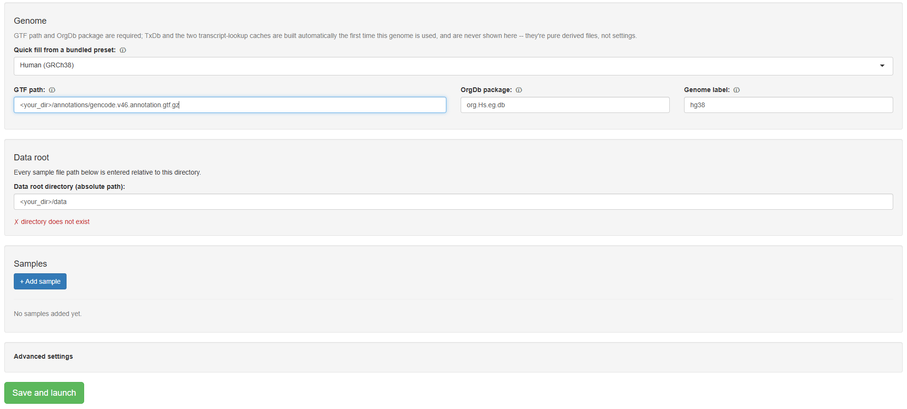
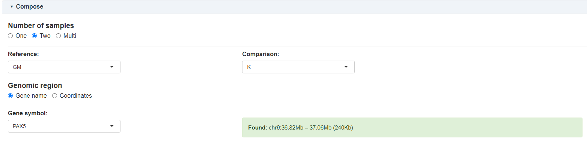
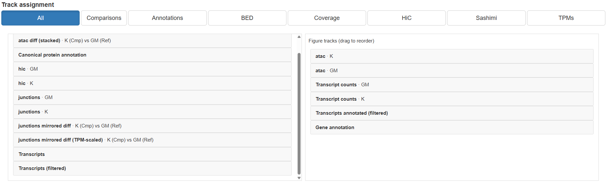
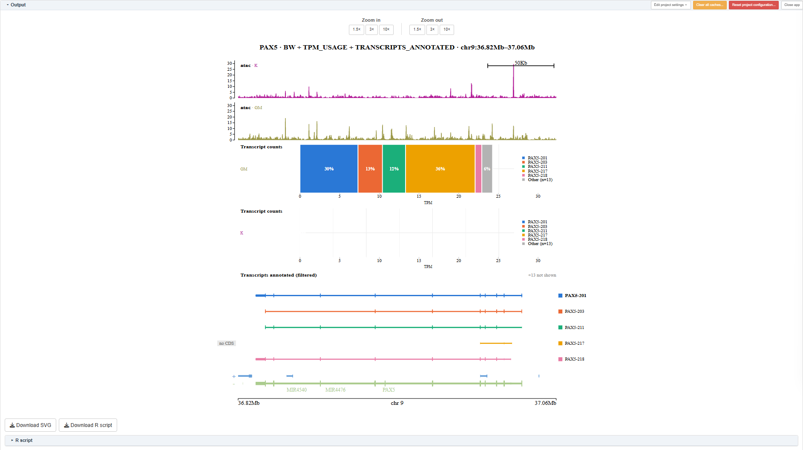

# Introduction

PlotTrellis is a Shiny app for composing multi-track genomic visualisations from
[plotgardener](https://bioconductor.org/packages/plotgardener/) without writing code: coverage
(ATAC/RNA-seq bigWig), Hi-C contact maps, splice junctions, transcript structure, and protein
domain annotation, all in one figure, over a gene or a set of genomic coordinates. Every figure
you build in the app can also be downloaded as a standalone R script that reproduces it exactly,
offline, without PlotTrellis or the app itself.

It's aimed at anyone who wants to look at their own sequencing data across these track types
without writing plotgardener code by hand for each figure -- most usefully biologists who have
processed data (bigWig, `.hic`/`.cool`, a GTF, salmon `quant.sf` output, and so on) but don't
want to iterate on plotting code themselves.

# Installation

```{r install, eval=FALSE}
if (!requireNamespace("pak", quietly = TRUE)) install.packages("pak")
pak::pkg_install("aleks-wehi/PlotTrellis")
```

# Launching the app

```{r setup, eval=FALSE}
library(PlotTrellis)
PlotTrellisApp(project_dir = tempdir())
```

`project_dir` is where this project's settings and cache/downloaded-script state live -- pass a
different directory per project so multiple projects don't share state.

# Setting up a project

The first time you launch the app against a `project_dir` with no existing project settings,
you get a setup screen instead of the composer:

```{r wizard-screenshot, echo=FALSE, out.width="100%"}

```

You can either import an existing `samples.txt` to prefill everything, or fill in the form by
hand: a genome (GTF path and an `OrgDb` package -- a few common genomes are offered as
presets), a data root directory that every sample's file paths are given relative to, and one
or more samples. Each sample can carry any mix of:

| Type | File format | Used by |
|---|---|---|
| `bw` | bigWig | coverage tracks (ATAC-seq, RNA-seq) |
| `hic` | `.hic`, `.cool`, `.mcool` | Hi-C contact map |
| `paired-end` | BEDPE | splice junctions |
| `bed` | BED12 | generic annotation overlay |
| `quantdir` | a salmon `quant.sf` directory | transcript usage (TPM) |

TxDb and the two transcript-lookup caches PlotTrellis needs are derived from the GTF
automatically the first time a genome is used (see the FAQ below) -- they're never entered here.

# Composing a figure

Once a project is set up, the main app has two pages: **Compose** and **Output**. On Compose,
pick how many samples you're comparing (one, two, or multi-sample), and choose a gene or a set of
coordinates:

```{r compose-screenshot-1, echo=FALSE, out.width="100%"}

```

Then drag tracks from the available list into the figure:

```{r compose-screenshot-2, echo=FALSE, out.width="100%"}

```

Tracks can be reordered by dragging within the figure list, and each track type has its own
settings (colours, height, value ranges, and so on) reachable from the project settings menu.

# Output and the downloaded script

Switching to Output renders the figure you've composed:

```{r output-screenshot, echo=FALSE, out.width="100%"}

```

Alongside the rendered SVG, the **Download R script** button gives you a single, self-contained
`.R` file: it embeds the exact source of every function PlotTrellis used to build this figure, so
running it later needs only base R and the packages it lists -- not PlotTrellis or the app.

# FAQ

- **The first figure for a new genome is slow to render -- is that expected?** Yes. The first
  time a GTF is used, PlotTrellis builds a `TxDb` and two transcript-lookup caches from it and
  saves them next to the GTF file; every later render against that same GTF reuses them and is
  fast. A handful of other per-gene caches (protein domain annotation, canonical-isoform lookups)
  live under `tools::R_user_dir("PlotTrellis", which = "cache")` instead, since they aren't tied
  to one genome file.
- **Where do I clear caches from if something looks stale?** The project settings menu has a
  "Clear all caches" action; see the two cache locations above if you'd rather do it by hand.

# Session info

```{r session-info}
sessionInfo()
```

# Citation

```{r citation, eval=FALSE}
citation("PlotTrellis")
```
