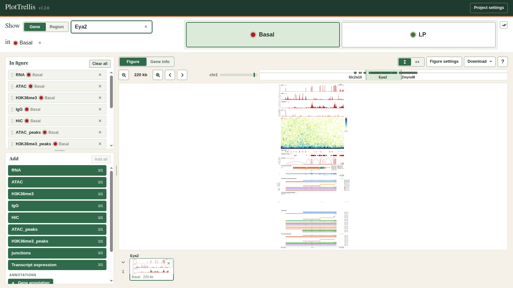

This page covers less obvious features. Close the app's tab to stop it.

```{r app-screenshot, echo=FALSE, out.width="100%", fig.alt="The app: gene box and samples at the top, the tracks to add and those in the figure on the left, the figure on the right."}

```

# Tips

- **Figure settings** allows to change title, fonts, heights and colours.
- The switch beside **Figure settings** fits the figure to its box's width or height.
- A kind of data under **Add** (e.g. **ATAC**) adds that track for every sample you picked.
  The arrow next to it lists the samples, to add it for only some.
- Drag tracks in **In figure** to reorder them.
- **Region**, next to the gene box, takes coordinates instead of a gene.
- **Project settings**, at the top, reopens the setup wizard and switches light and dark.
- Figures are deleted each rerun. Save ones you want to keep.

# Compare two conditions

Pick exactly two samples. The figure reads "comparison relative to reference", and the arrow button
between them switches which is the reference. **Add** now offers **Comparisons** (e.g. `ATAC
diff`, `Junctions diff`) for data both samples have under the same name.

# Saved figures

Every figure you generate joins the strip below it: click one to open it again, or hold
Space to flick back to the one before. The **×** on a figure deletes it.

# Gene info

Next to the figure, **Gene info** lists the gene's transcripts with their TPM in the picked
samples, and its canonical protein's domains, linked to UniProt.

# Downloads

- **Download**: SVG, or PNG and JPEG at 300 dpi, or an **R script** that redraws the figure
  with plotgardener, to fine-tune in R.

# Keyboard shortcuts

Press **?** in the app for this list.

| Keys | Does |
|---|---|
| / | Jump to the gene box |
| Ctrl + Enter | Generate the figure |
| 1 to 9 | That sample, on or off |
| A / 0 | All samples / no samples |
| Shift + A / Shift + 0 | Add all tracks / clear the tracks |
| Space (hold) | Flick to the figure shown before |
| [ / ] | Earlier / later figure |
| Ctrl + S | Download the SVG on screen |

On a Mac, use Cmd for Ctrl.

<style>
.code-box { position: relative; margin: 1.2em 150px 1.2em 0; }
@media screen and (max-width: 991px) { .code-box { margin-right: 0; } }
.code-box pre { margin: 0; padding-top: 12px; padding-bottom: 12px; }
.copy-code { position: absolute; top: 4px; right: 4px; font-size: 12px; opacity: 0; }
.code-box:hover .copy-code, .copy-code:focus { opacity: 1; }
</style>
<script>
if (navigator.clipboard) document.querySelectorAll("pre").forEach(function (pre) {
  var button = document.createElement("button");
  button.className = "copy-code";
  button.textContent = "Copy";
  var code = pre.querySelector("code") || pre;
  var box = document.createElement("div");
  box.className = "code-box";
  pre.parentNode.insertBefore(box, pre);
  box.appendChild(pre);
  button.onclick = function () {
    navigator.clipboard.writeText(code.innerText).then(function () {
      button.textContent = "Copied";
      setTimeout(function () { button.textContent = "Copy"; }, 1500);
    });
  };
  box.appendChild(button);
});
</script>
